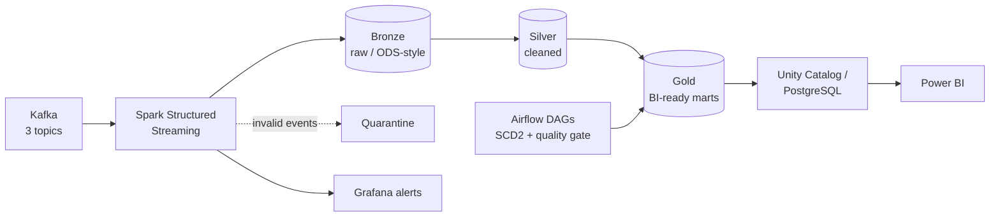

# Fatma Moataz

**DataOps / Data Engineer** · Batch and real-time pipelines · Python · SQL · Spark · Kafka · Airflow · Hadoop

Cairo, Egypt · [LinkedIn](https://www.linkedin.com/in/fatma-moataz-31a457264/) · fatmamoataz65@gmail.com · [Kaggle](https://www.kaggle.com/fatmamoataz) · [LeetCode](https://leetcode.com/u/fatmamoataz65/)

---

## About

Junior Data Engineer (BSc Computer Science, Alexandria University, *Excellent with Honors*) and graduate of the **NTI DataOps Engineering Hire Ready** program.

I build repeatable batch and near real-time ETL/ELT pipelines that move data from relational sources into warehouses, staging layers (Bronze/Silver) and BI-ready data marts. I care about the parts that keep pipelines trustworthy in production: data quality checks, reconciliation, audit logging, monitoring and alerting, CI/CD, and governed access.

Looking for: **DataOps / Data Engineer roles**, especially with transactional or payments-style data.

---

## Core Skills

| Area | Tools |
|---|---|
| **Pipelines & Big Data** | Apache Spark / PySpark (Structured Streaming), Kafka, Airflow, Hadoop (HDFS), Hive, Databricks, Informatica PowerCenter, SSIS |
| **Warehousing & Modeling** | Star schema, SCD2, medallion architecture (Bronze/Silver/Gold), data marts, ODS-style staging, Delta Lake, Parquet, Unity Catalog |
| **Databases & SQL** | Oracle, PostgreSQL, SQL Server, MySQL, MongoDB, Redis; CTEs, window functions, execution-plan analysis, query tuning |
| **DataOps & Reliability** | Git, GitHub Actions, CI/CD, Docker / Docker Compose, Grafana alerting, ETL audit logging, reconciliation, quarantine pipelines, event deduplication |
| **Languages & Systems** | Python (Pandas, NumPy), SQL, Bash, Linux; also Java, JavaScript/TypeScript |
| **BI & Integration** | Power BI, Grafana, REST APIs |

Also familiar with: NestJS, Node.js, OpenAI API, Hugging Face (useful for building data/AI integrations).

---

## Featured Projects

### FunnelStream: Real-Time E-Commerce Analytics Platform
`PySpark` `Spark Structured Streaming` `Kafka` `Delta Lake` `Airflow` `Databricks` `PostgreSQL` `Grafana` `Power BI` `Docker`

End-to-end batch and near real-time ELT pipeline for **1-2M transactional events**.

- Checkpoint recovery and **exactly-once delivery** via Delta `MERGE`.
- **Data quality:** event deduplication, quarantine pipeline (10+ error codes), bot detection, 10-minute watermark for late events, automated reconciliation within **2% tolerance**.
- **Orchestration:** Airflow DAGs for SCD2 dimension loads, Gold-layer builds and a SQL quality gate before publication.
- **Governance & monitoring:** Gold layer served through Databricks Unity Catalog (lineage), PostgreSQL fallback, Grafana alerting on pipeline health.
- **Delivery:** 5-page Power BI dashboard (funnel, ROAS, CPA) for business stakeholders.

[Repository](https://github.com/FatmaMoataz/REPLACE-WITH-FUNNELSTREAM-REPO)

---

### Olympics Data Warehouse ETL
`Informatica PowerCenter` `Oracle` `SQL`

- Designed an Oracle warehouse with a **star schema** (6 dimensions + participation fact).
- Built ETL with reusable mapplets (Joiner, Aggregator, DECODE expressions); monitored sessions in Workflow Monitor.
- Implemented an **`ETL_AUDIT_LOG`** table (rows read, written, rejected, status, errors) and a **safe-rerun recovery plan** separating DDL from repeatable DML loads.

[Repository](https://github.com/FatmaMoataz/REPLACE-WITH-OLYMPICS-REPO)

---

### End-to-End Sales Data Pipeline on Hadoop
`HDFS` `Spark` `Hive` `Parquet` `Python` `Bash` `Linux`

- Built a data lake ingestion flow: generated 10,000 synthetic sales rows, loaded them to HDFS, converted to **Snappy-compressed Parquet** with Spark.
- Modeled a star schema (4 dimensions + sales fact) with Hive external tables; wrote HiveQL analytics (revenue, profit, monthly trends, 4-way star joins).
- Automated ingestion of a **577 MB CSV and 477 MB JSON** into an organized HDFS structure, with size and content validation in Bash and the HDFS CLI.

[Repository](https://github.com/FatmaMoataz/REPLACE-WITH-HADOOP-REPO)

---

### Flowio: AI-Powered Project Management Platform *(Graduation Project)*
`NestJS` `PostgreSQL` `REST APIs` `LLM`

- Built REST APIs with secure authentication and role-based authorization in an Agile Scrum team, on a PostgreSQL backend with LLM integration.

---

## Experience

**DataOps Engineering Intern**, National Telecommunication Institute (NTI), Cairo · *Jul 2026 – Oct 2026*
Built and automated batch and real-time pipelines with Hadoop, Spark, Hive, Kafka, Informatica, SSIS, Python and SQL on Linux. Implemented CI/CD for data workflows.

**AI Agent Intern**, Orange Digital Center, Cairo · *Jul 2026*
Built automation workflows integrating LLMs (OpenAI API) into business processes, plus backend services for document and text processing.

**LLM Intern**, Tips Hindawi, Remote · *Mar 2026 – Apr 2026*
Developed LLM applications with Hugging Face; applied prompt engineering and model evaluation.

**Software Engineering Intern**, Microsoft, Hybrid · *Jul 2024*
Built a Carpool Management System in an Agile team (React, .NET REST APIs); managed SQL Server databases and data integration.

---

## Education & Certifications

- **BSc Computer and Information Science**, Alexandria University, Faculty of Science (Software Industry and Multimedia), Jun 2026, *Excellent with Honors*
- DataOps Engineering Training Program, NTI (2026)
- Big Data & Data Engineering, Egyptian Engineers Syndicate (2025)
- AI Fundamentals with Capstone Project, IBM (2026)
- AWS Educate: Introduction to Generative AI, AWS (2025)

---

## Other Work

AI Recipe Generator (Mistral-7B + FastAPI), Laptop Price Prediction (ML), NestJS backends (Socket.io, Stripe, Redis), and a React booking system are in my repositories.
